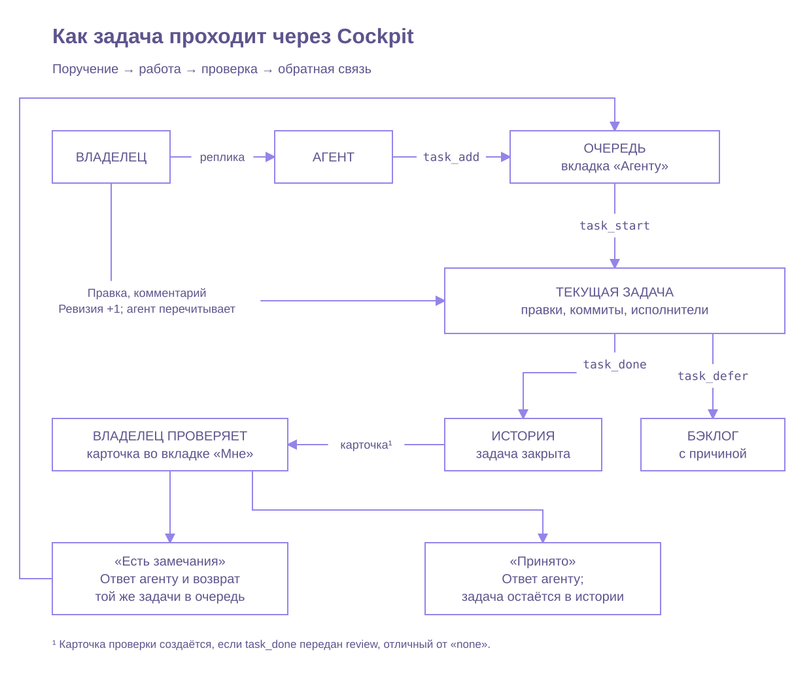
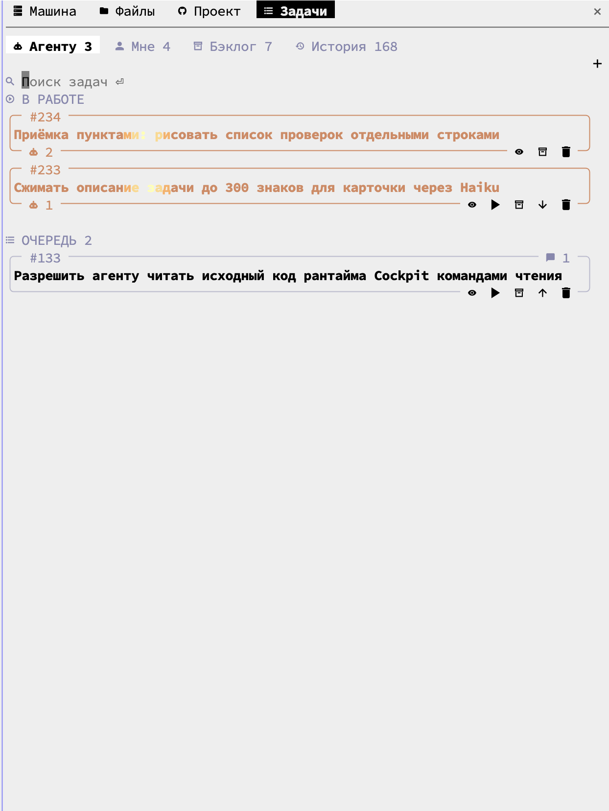
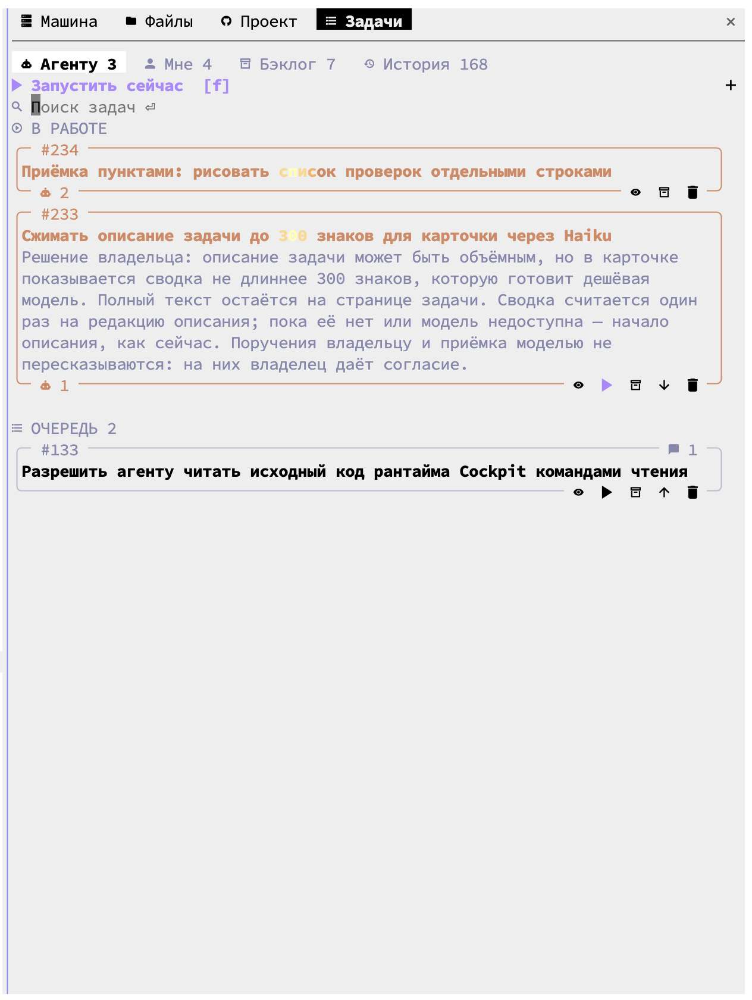
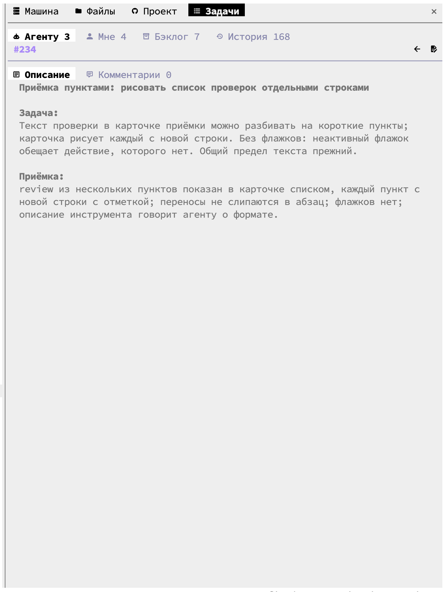
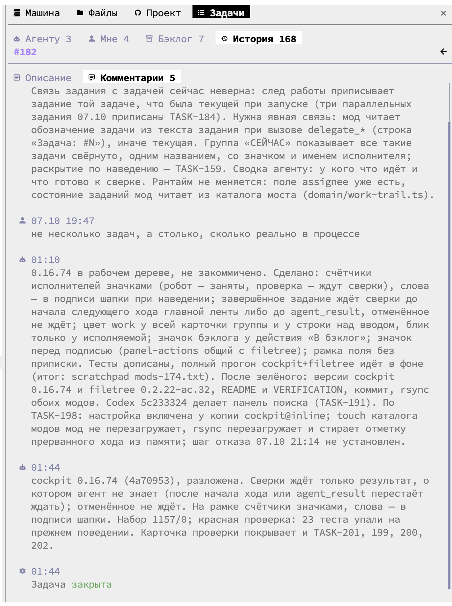

# Cockpit Tasks

[English](README.md)

## Что это и для кого

Cockpit Tasks — отдельная панель задач для Claude Code. Она нужна тем,
кто поручает работу агенту и хочет видеть очередь, принимать сделанное,
откладывать задачи в бэклог и возвращаться к истории. Поиск находит задачи
по номеру и тексту. Имя самого мода — `cockpit`; команды и сохранённые
настройки используют это имя.

## Как проходит задача



`task_add` записывает работу, `task_start` делает задачу текущей. После выполнения
и проверок `task_done` закрывает её в историю и создаёт карточку проверки во
вкладке «Мне», если `review` отличается от `"none"`. `task_defer` сохраняет
причину и отправляет незавершённую работу в бэклог.

Правки и комментарии владельца меняют ревизию; агент должен прочитать их перед
закрытием или откладыванием задачи. «Принято» доставляет ответ агенту и оставляет
задачу в истории. «Есть замечания» возвращает ту же доступную задачу в очередь
с прежним итогом и комментарием владельца. Если исходная задача недоступна,
ответ предлагает агенту записать исправление новой задачей. Вызов `task_add`
со `start: true` позволяет сразу записать и взять работу.

Для правки схемы есть [исходник draw.io](docs/diagrams/task-workflow.drawio).

## Снимки экрана

Настоящие снимки терминала от 8 октября 2026 года. Они показывают интерфейс до
выпуска 0.16.98; номера задач и комментарии разработки служат примерами.
Снимки не подтверждают изменения, внесённые после этой даты. Общий снимок
обрезан до панели; метаданные EXIF и XMP удалены. Сохранённые пиксели и текст
остались без изменений.

| Очередь агенту | Развёрнутое описание |
| --- | --- |
|  |  |
| **Страница задачи** | **История и комментарии** |
|  |  |

## Требования

Нужны Linux или macOS, Claude Code с поддержкой модов, Python 3.10+ и Git.
Установщик проверяет возможности CLI и контракт мода. Версия 2.1.289 служит
порогом исходного API, а не обещанием совместимости со всеми ранними выпусками.
Каталог проекта может быть обычной папкой без собственного Git-репозитория.

Nerd Font необязателен. Если значки выглядят неправильно, выберите `glyphs=plain`.

## Установка одной командой

Сохраните этот каталог в постоянном месте. Откройте в нём терминал и выполните:

```sh
sh install.sh
```

Установщик проверит Python, Git и Claude Code, создаст ссылку
`~/.local/bin/cockpitctl` на вложенный `tools/cockpitctl.py` и выполнит настоящий
запрос чтения во временном состоянии. Затем он зарегистрирует локальный
каталог модов `cockpit-tasks` и установит только `cockpit` для текущего
пользователя. Права администратора, `sudo` и менеджер пакетов не используются.
База задач в домашнем каталоге при установке не создаётся.

Перезапустите Claude Code. Сохраните каталог поставки на месте: ссылка на
рантайм и локальный каталог модов используют его путь. Повторный запуск
`sh install.sh` пропускает выполненные шаги и включает мод, если он отключён.
Чужой файл `cockpitctl` или одноимённый каталог модов установщик не заменяет.
В строках «поставлено» и «пропущено» показан результат проверки установки;
в «не настроено» для этой поставки остаётся только напоминание о шрифте.

## Первые шаги

Введите `/tasks`, чтобы открыть панель. Чтобы добавить первую задачу, введите
`/tasks add <текст>`, заменив `<текст>` своим поручением, например
`/tasks add Проверь обработку ошибок при входе`.

В панели четыре вкладки:

- «Агенту» показывает текущую работу агента и очередь задач.
- «Мне» показывает вопросы агента и то, что нужно проверить или решить владельцу.
- «Бэклог» хранит отложенные задачи, которые можно вернуть в работу.
- «История» показывает завершённые задачи и результаты.

Поле поиска находится под вкладками. Введите номер или слова из задачи,
чтобы найти её и открыть подробности. Панель обычно открывается при старте
сессии; это поведение меняет настройка `autoOpen`.

## Настройки

На странице остаются полное описание и комментарии. Для карточки длинное
описание может получить кешированную сводку Haiku; поручения владельцу и текст
приёмки сохраняются в исходном виде. `summarizeDescriptions=false` отключает
новые вызовы модели. При недоступном рантайме штатные инструменты задач доступны.

Таблица создаётся при выгрузке из `userConfig` в `plugin.json` мода.
Описания и значения по умолчанию берутся из текущей версии мода.

| Настройка | По умолчанию | Описание из мода |
| --- | --- | --- |
| `summarizeDescriptions` | `true` | Готовить сводку длинного описания дешёвой моделью один раз; полный текст остаётся на странице задачи |
| `autoOpen` | `true` | Показывать панель задач при старте сессии, сохраняя фокус в строке Claude Code |
| `redirectTodos` | `true` | Перенаправлять штатные TodoWrite и TaskCreate/TaskUpdate/TaskList/TaskGet на инструменты задач Cockpit |
| `compactTaskCalls` | `true` | Показывать вызовы инструментов задач Cockpit короткой строкой с номером и исходом, без отдельного блока результата |
| `resumeAfterCompact` | `false` | После /compact агент сам продолжает задачу, работу над которой ты прервал. Выключено по умолчанию: с этой настройкой /compact означает «сжать и продолжить» |
| `glyphs` | `"auto"` | Как в FileTree: auto, Nerd Font или запасные Unicode |
| `timeZone` | `""` | Пояс для времени комментариев и истории задач: имя IANA, например Europe/Kyiv. Пусто — пояс машины, где запущен Claude Code (при работе по SSH — пояс сервера) |

`glyphs` принимает `auto`, `nerd` или `plain`. Значение `plain` использует
обычные знаки Unicode. Пустой `timeZone` выбирает пояс машины, где работает
Claude Code; для явного пояса укажите имя IANA, например `Europe/Kyiv`.
`resumeAfterCompact` по умолчанию выключен: включайте его, если после `/compact`
агент должен сам продолжать прерванную задачу.

Просмотр настроек:

```sh
claude plugin configure cockpit@cockpit-tasks --json
```

Пример изменения значков и автооткрытия:

```sh
printf '%s\n' '{"glyphs":"plain","autoOpen":"false"}' | claude plugin configure cockpit@cockpit-tasks --values-stdin
```

Вход CLI принимает строковые значения, включая `"true"` и `"false"` для
булевых настроек. Пропущенные ключи сохраняют прежнее значение.
Перезапустите Claude Code после изменения настроек.

## Если список пуст

На вкладке «Агенту» без задач можно сразу ввести новую задачу в поле
«Новая задача» или воспользоваться `/tasks add <текст>`. Пустая вкладка «Мне»
означает, что агенту сейчас не нужен ваш ответ. В бэклоге появятся отложенные
задачи, в истории — завершённые. Пустая выдача поиска означает, что совпадений
нет; очистите запрос, чтобы вернуться к списку.

Если панель сообщает о недоступном рантайме, проверьте Python 3.10+, Git
и ссылку `~/.local/bin/cockpitctl`, затем повторите `sh install.sh` из каталога
поставки. Совет о частном установщике `agentctl`, который может встретиться
в сообщении мода, к этой самостоятельной поставке не относится.

## Где лежат данные

По умолчанию задачи и их история хранятся в
`~/.local/state/agent-config/cockpit/cockpit.db`. Мод хранит базу на этой машине
и не отправляет её на сервер или в общее хранилище. Состояние панелей Claude Code
сохраняет отдельно в своём локальном хранилище модов. При работе через SSH
база находится на машине, где запущен Claude Code.

Если вы задаёте `COCKPIT_STATE_DIR` или `XDG_STATE_HOME`, рантайм использует
этот каталог состояния. По умолчанию он также сохраняет принятые сообщения
локально; эта база не входит в поставку. Установщик проверяет рантайм во
временном каталоге и удаляет проверочное состояние после запроса.

## Обновление

Закройте Claude Code и обновите файлы поставки в том же каталоге. Если это
Git-копия отдельного репозитория, получите новый выпуск обычным `git pull --ff-only`.
Затем выполните из каталога поставки:

```sh
sh install.sh
claude plugin marketplace update cockpit-tasks
claude plugin update cockpit@cockpit-tasks --scope user
```

Перезапустите Claude Code. Повторная установка проверяет рантайм; обновление
мода выполняет отдельная команда `plugin update`. База задач остаётся в
каталоге состояния, а имя мода и ключи настроек сохраняются.

## Удаление

Закройте Claude Code и выполните:

```sh
claude plugin uninstall cockpit@cockpit-tasks --scope user
claude plugin marketplace remove cockpit-tasks
```

Затем удалите созданную установщиком ссылку `~/.local/bin/cockpitctl`, если она
по-прежнему указывает на `tools/cockpitctl.py` этой поставки. После этого можно
удалить сам каталог поставки. База в каталоге состояния остаётся для следующей
установки; её удаление — отдельное решение владельца.

## Состав и лицензия

В поставку входят только мод «Задачи», его Python-рантайм, локальный каталог
модов, общий установщик и нужные лицензии. Остальные девять модов набора,
включая мост исполнителей, не входят. Некоторые служебные тесты, внутренний
журнал проверки и конфигурация компилятора исключены: для работы панели
они не нужны. Эта поставка предназначена для установки, а не для полного
повторения проверок исходного набора.

Автор поставки: Roman Dmytriev. Copyright (c) 2026 Roman Dmytriev.

Лицензия — [MIT](LICENSE). Сохранённые уведомления о заимствованном коде:
[THIRD_PARTY_NOTICES.md](THIRD_PARTY_NOTICES.md).
